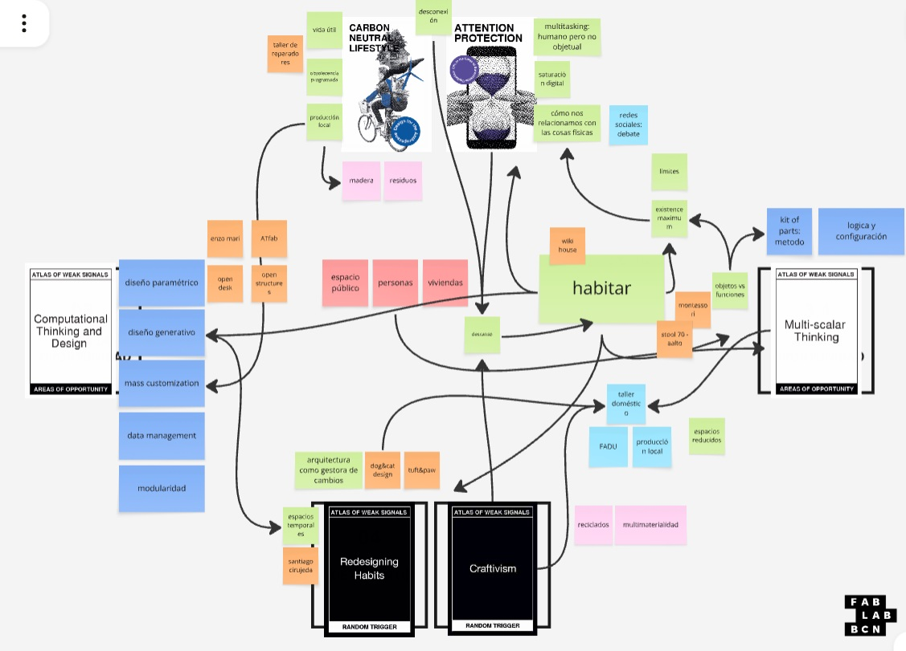

---
hide:
    - toc
---
# MD01 - Proyecto y contexto

## Atlas de Weak Signals y construcción inicial del territorio de proyecto

### Punto de partida

Al comenzar el módulo no tenía un proyecto definido. Tenía, en cambio, una serie de intereses que aparecían de manera bastante dispersa: fabricación digital, diseño computacional, objetos y espacios adaptables, personalización, producción local, materialidad, sostenibilidad y formas de habitar que pudieran responder mejor a necesidades cambiantes.

El ejercicio del **Atlas of Weak Signals** me resultó útil justamente porque me obligó a no comenzar por una solución. En lugar de decidir qué quería diseñar, tuve que mirar un conjunto amplio de señales, áreas de oportunidad y conceptos detonantes, seleccionar aquellos que me generaban interés y empezar a construir relaciones entre ellos.

### Selección de señales débiles

Las dos señales que elegí fueron **Carbon Neutral Lifestyles** y **Attention Protection**.

**Carbon Neutral Lifestyles** conectaba con intereses que ya tenía alrededor de la vida útil de las cosas, la obsolescencia, la reparación, el uso de materiales, la producción local y la posibilidad de aprovechar mejor aquello que ya existe. Más que pensar únicamente en producir algo nuevo, me interesaba la pregunta por cómo diseñar para extender, adaptar, reutilizar o transformar.

**Attention Protection**, en cambio, introducía una dimensión más relacionada con los hábitos y la experiencia cotidiana. Me interesaba pensar cómo los entornos físicos y los objetos que nos rodean influyen en nuestra manera de habitar, prestar atención, descansar, relacionarnos o desconectarnos de la saturación digital. Esta señal fue la que inicialmente acercó mi exploración hacia objetos de pequeña escala y hacia la idea de generar experiencias físicas alejadas de las pantallas.

### Áreas de oportunidad

Elegí **Computational Thinking and Design** y **Multi-scalar Thinking**.

La primera se relaciona directamente con mi práctica profesional y con mi interés por el diseño paramétrico, generativo y basado en sistemas. En el tablero aparecieron conceptos como **mass customization, modularidad, data management y diseño paramétrico**, que me llevaron a pensar en una tensión que me interesa especialmente: la relación entre **estandarización y personalización**. La fabricación digital permite producir mediante sistemas relativamente estandarizados y, al mismo tiempo, introducir variación, adaptación y especificidad.

**Multi-scalar Thinking** me permitió ampliar el problema. Un proyecto no necesariamente tiene que vivir en una única escala: puede comenzar en el material, convertirse en componente, formar un sistema constructivo, modificar un espacio y finalmente afectar una forma de habitar. Esta mirada es importante porque evita que la investigación quede limitada de antemano a la escala del objeto.

### Conceptos detonantes

Los conceptos seleccionados fueron **Redesigning Habits** y **Craftivism**.

**Redesigning Habits** reforzó la idea de que diseñar no significa solamente producir nuevas formas, sino también modificar relaciones y prácticas existentes. Una intervención pequeña puede cambiar la manera en que un espacio se usa, se percibe o se adapta a distintas situaciones.

**Craftivism** apareció vinculado a mi interés por el hacer, la fabricación y la relación entre conocimiento técnico, materialidad y producción local. En mi lectura del concepto, me interesó especialmente la posibilidad de vincular herramientas digitales con una lógica más cercana a la fabricación situada, la reparación, la experimentación material y la capacidad de producir o modificar elementos de manera local.

### Construcción del Design Space

Al trasladar las tarjetas al **Design Space**, el ejercicio dejó de ser una selección de temas aislados y empezó a funcionar como un mapa de relaciones.

En el centro terminó apareciendo con fuerza la idea de **habitar**. Alrededor de ella se conectaron cuestiones vinculadas con personas, viviendas, espacios existentes, objetos y funciones, configuración, fabricación doméstica, producción local, modularidad, vida útil, residuos, personalización y nuevas formas de producción.

También comenzaron a aparecer referencias vinculadas con diseño abierto, estructuras configurables, espacios temporales, fabricación digital y arquitectura capaz de absorber cambios.

En retrospectiva, el valor principal del tablero no fue llegar a una respuesta concreta, sino hacer visible un territorio de interés. Muchas de las conexiones que aparecieron eran intuitivas o incluso difíciles de explicar inicialmente, pero al colocarlas juntas comenzaron a mostrar patrones.

## Primera síntesis

Como cierre del ejercicio formulé la siguiente frase:

> **“Quiero explorar el habitar humano a través de los objetos físicos para crear entornos ricos en estímulos saludables.”**

La frase fue útil porque permitió sintetizar una parte importante de lo que estaba apareciendo: el interés por el habitar, por la experiencia física y por la capacidad de los elementos materiales de modificar nuestros entornos y comportamientos.

Sin embargo, hoy la considero una síntesis provisoria. Al poner demasiado énfasis en “los objetos físicos”, deja afuera una parte del territorio que comenzó a hacerse más evidente después del módulo: mi interés sigue estando profundamente relacionado con la arquitectura, lo que no elimina la consideración desde lo objetual pero lo relaciona con la escala de lo edificado.

## Relectura y actualización

A medida que continué pensando el proyecto y conversándolo en tutorías, empecé a reconocer una pregunta más amplia que atraviesa varios de mis intereses: *cómo intervenir sobre espacios y arquitecturas existentes para permitir que se adapten, mejoren o prolonguen su vida útil sin necesidad de reemplazarlos completamente*.

Esto abre posibilidades en distintas escalas. Podría tratarse de un componente que mejore el comportamiento ambiental de una fachada, por ejemplo un sistema de celosías fabricadas digitalmente; de la exploración de nuevos procesos materiales, como impresión 3D en cerámica; de paneles o componentes prefabricados que permitan personalizar una vivienda; o de otros sistemas todavía no definidos.

Por ahora, estas posibilidades funcionan como hipótesis de exploración.

El cambio más importante es que ya no pienso necesariamente el objeto como resultado final. Me interesa más pensar el objeto, componente o sistema como interfaz capaz de transformar una arquitectura existente. Allí aparecen nuevamente la fabricación digital, el diseño computacional y la personalización, no solamente como herramientas de producción sino como maneras de cuestionar cuánto debe estar definido de antemano y cuánto puede quedar abierto a diferentes usuarios, contextos y momentos.

### Una continuidad con investigaciones anteriores

Al revisar este proceso reconocí también una continuidad con mi Trabajo Final de Carrera, *Convert*. En aquel proyecto ya investigaba la posibilidad de incorporar intervenciones complementarias a edificios existentes, capaces de responder a nuevas necesidades sin reemplazar la arquitectura original. También aparecían la adaptabilidad, la personalización por parte del usuario, la indeterminación y la búsqueda de sistemas materiales y técnicos que permitieran que la arquitectura continuara transformándose después de construida.

No considero que el proyecto actual tenga que retomar aquella propuesta ni resolver el mismo problema pero me parece interesante reconocer que existe una línea de investigación personal que reaparece,la arquitectura entendida menos como un objeto terminado y más como una estructura capaz de absorber cambios.

## Estado actual

MD01 funcionó como una primera cartografía de intereses y permitió empezar a identificar un territorio desde el cual investigar.

Hoy ese territorio podría sintetizarse alrededor de algunas preguntas abiertas:

- ¿Cómo puede la fabricación digital ayudar a adaptar y prolongar la vida útil de arquitecturas existentes?
- ¿Dónde se encuentra el equilibrio entre sistemas estandarizados y posibilidades reales de personalización?
- ¿Qué tipo de intervenciones mínimas pueden producir transformaciones espaciales, ambientales o de uso con impacto suficiente?
- ¿Cómo se relacionan material, proceso de fabricación, componente, edificio y forma de habitar?
- ¿En qué escala intervenir para que una solución pueda ser específica y, al mismo tiempo, replicable o adaptable?

La principal conclusión de este módulo es, entonces, metodológica. El proceso comenzó con temas aparentemente dispersos, pasó por la selección y relación de señales y terminó construyendo un campo de preguntas. La frase inicial permitió una primera convergencia, pero el proyecto está abierto y mutando. Más que definir prematuramente qué fabricar, el objetivo en esta etapa es seguir delimitando la propuesta, qué problemas busca abordar y desde qué escala tiene sentido hacerlo.
