---
hide:
    - toc
---
# MI01 - Innovación abierta y distribuida

## Aplicación de los principios de Distributed Design

En este módulo, la consigna fue analizar el proyecto a partir de los principios del *Distributed Design*. Para hacerlo, trabajé con las preguntas orientadoras propuestas en la actividad: qué problema buscaba abordar, en qué contexto surgía, para quién generaba valor y cómo podía incorporar las dimensiones **abierta, colaborativa, regenerativa y ecosistémica** del diseño distribuido.

En ese momento estaba explorando una posible línea de objetos domésticos de pequeña escala, vinculados a actividades cotidianas que nos permitieran conectar más con lo físico y menos con las pantallas. Me interesaba también cuestionar la relación con los objetos que usamos, cuánto podemos adaptarlos, modificarlos o repararlos y cuánto participamos realmente de su producción.

Al responder las preguntas de la consigna identifiqué, por un lado, personas que valoran objetos durables, transformables y capaces de acompañar diferentes usos y por otro, una posible red de diseñadores, fabricantes y talleres locales que podría intervenir en el desarrollo y la producción.

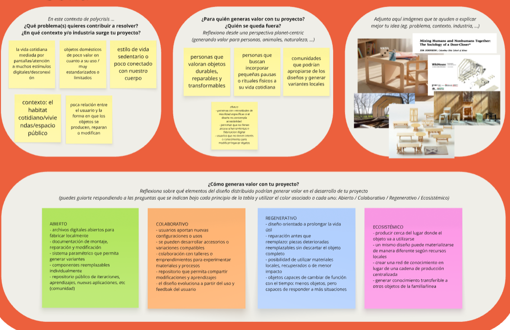

La parte más interesante del ejercicio fue pensar el valor del proyecto más allá del producto terminado. En la dimensión **abierta**, imaginé archivos de fabricación y documentación compartidos, junto con sistemas paramétricos que permitieran generar variantes. En la **colaborativa**, pensé en usuarios y fabricantes que pudieran aportar modificaciones, accesorios o nuevos usos. Desde lo **regenerativo**, aparecieron la reparación, los componentes reemplazables y la posibilidad de prolongar la vida útil. Finalmente, la dimensión **ecosistémica** me permitió considerar redes de producción local, materiales disponibles en cada contexto y conocimiento transferible entre proyectos.

No todas estas ideas están resueltas ni garantizan por sí mismas un impacto positivo. Las entiendo como criterios que podrían orientar decisiones de diseño y que más adelante habría que poner a prueba.

## Una nueva lectura desde la arquitectura

Al revisar el ejercicio en relación con las exploraciones posteriores del módulo de Diseño, empecé a preguntarme cómo podrían trasladarse estas ideas a una escala arquitectónica. No lo considero todavía un cambio definitivo de proyecto, sino una oportunidad para ampliar la investigación: pasar de pensar en un objeto adaptable a imaginar sistemas de componentes y reglas capaces de producir distintas configuraciones.

En esta escala, lo abierto podría vincularse con compartir detalles, modelos y criterios constructivos; lo colaborativo, con incorporar el conocimiento de fabricantes, constructores y usuarios; lo regenerativo, con sistemas desmontables, reparables y adaptables; y lo ecosistémico, con la posibilidad de combinar información digital compartida y capacidades productivas locales.

## Referencias para seguir explorando

Volví a algunos proyectos que me interesan desde hace tiempo y encontré otros que ayudan a pensar estas relaciones desde ángulos diferentes:

- **[Wikkelhouse](https://wikkelhouse.com/):** me interesa por la vivienda entendida como sistema modular de segmentos combinables, con posibilidades de montaje y transformación.

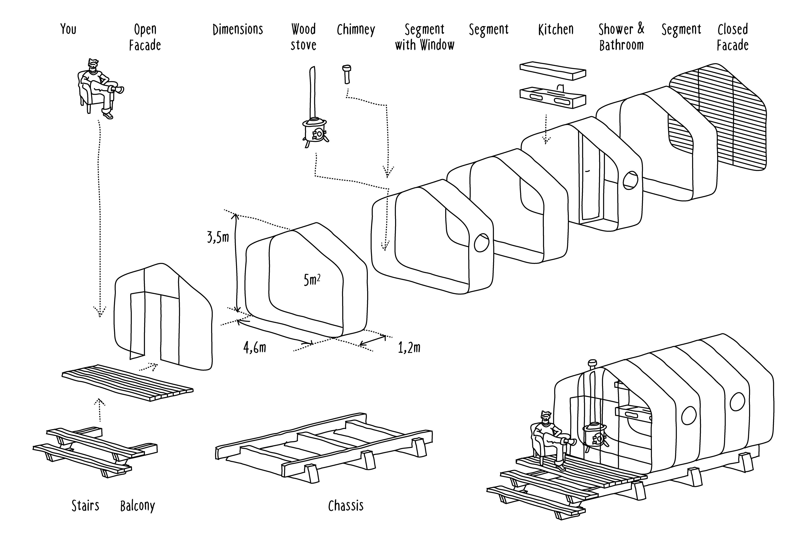
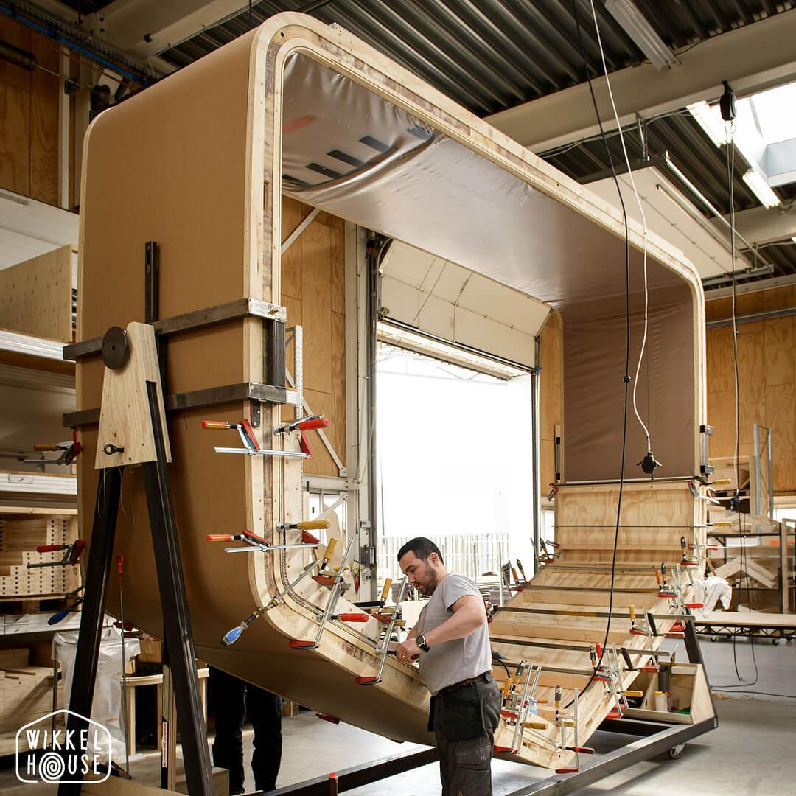
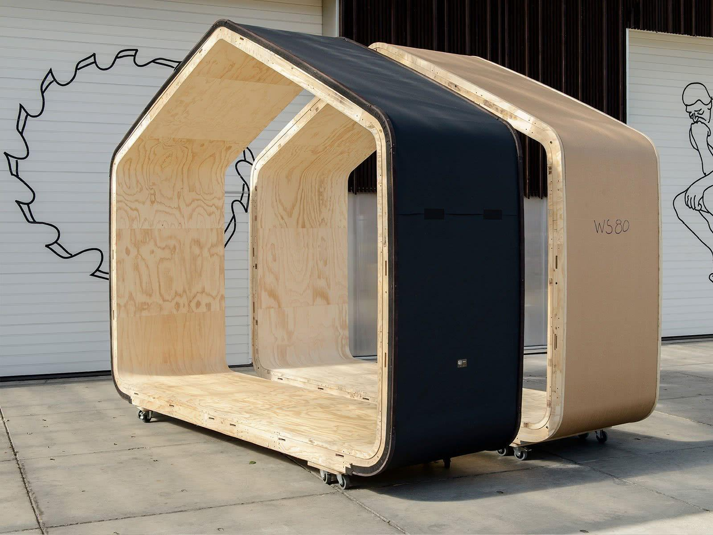

- **Erwin Hauer, *Continua*:** sus celosías me ayudan a pensar cómo el diseño de una unidad y sus reglas de repetición pueden generar un sistema arquitectónico de mayor escala.

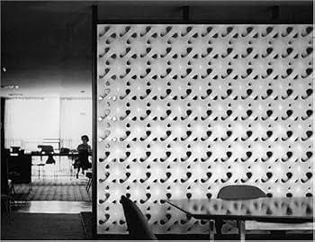
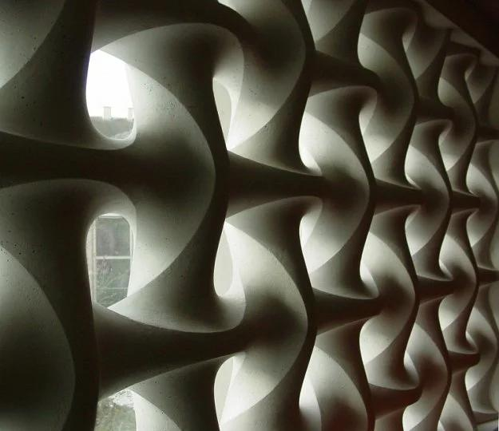

- **APT No7, de Sstudiomm:** me interesa especialmente el vínculo entre diseño paramétrico, ladrillo y saber constructivo local, me parece un caso en el que las instrucciones digitales pueden dialogar con técnicas tradicionales.

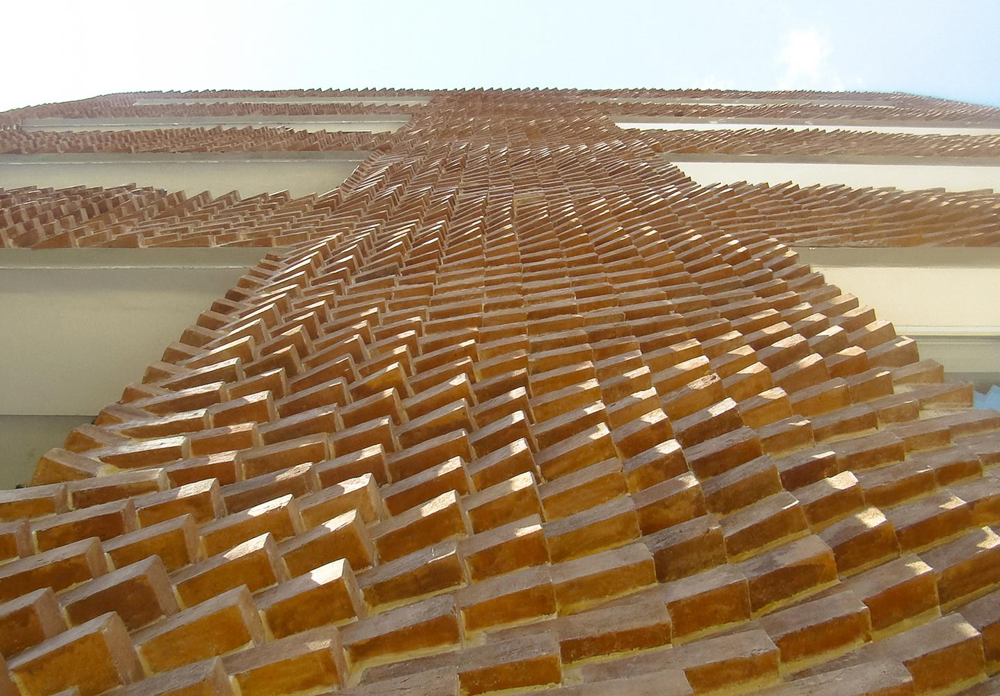
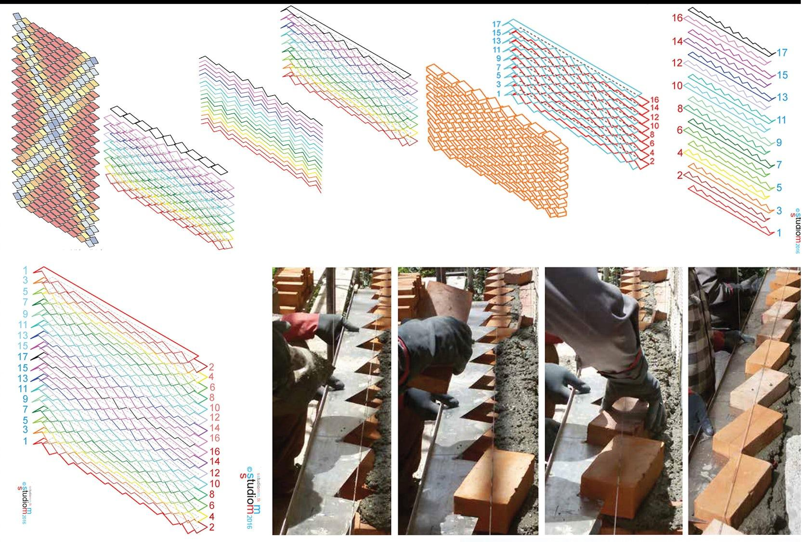

- **[WikiHouse](https://www.wikihouse.cc/):** aporta una referencia más directamente relacionada con archivos compartidos y fabricación digital distribuida pero enfocada en arquitectura.

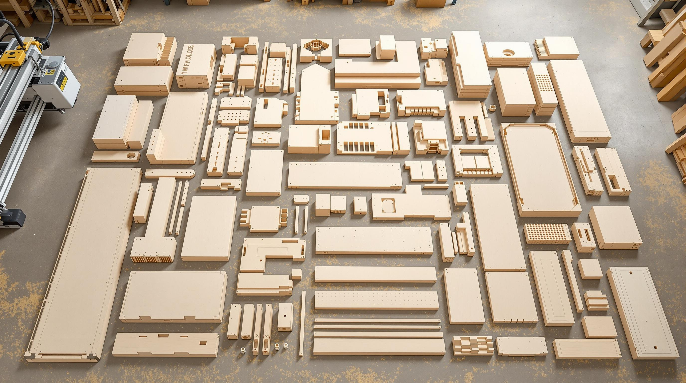
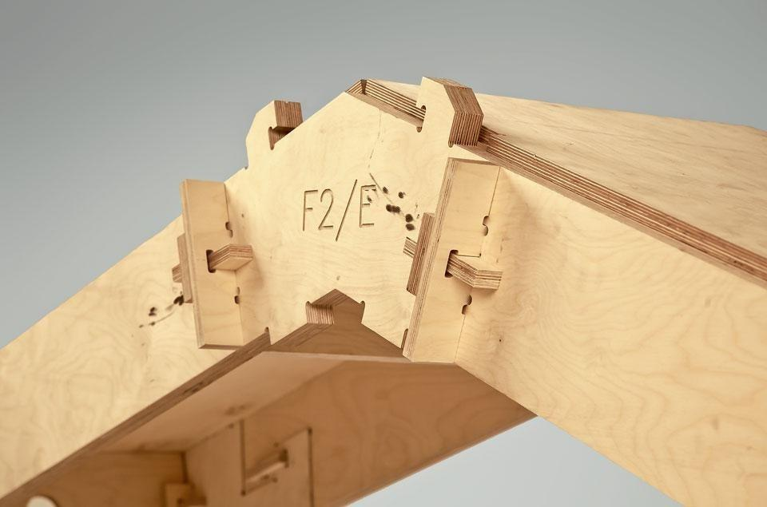

- **[OpenStructures](https://openstructures.net/):** plantea una pregunta que me parece fundamental y es pensar en qué reglas deberían ser comunes para permitir que otras partes del sistema puedan variar.

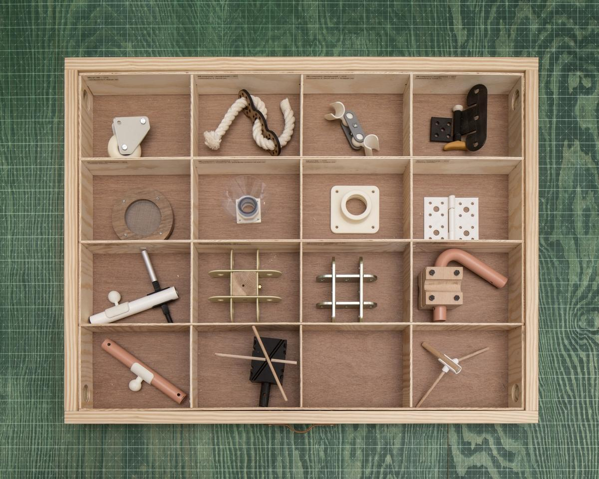
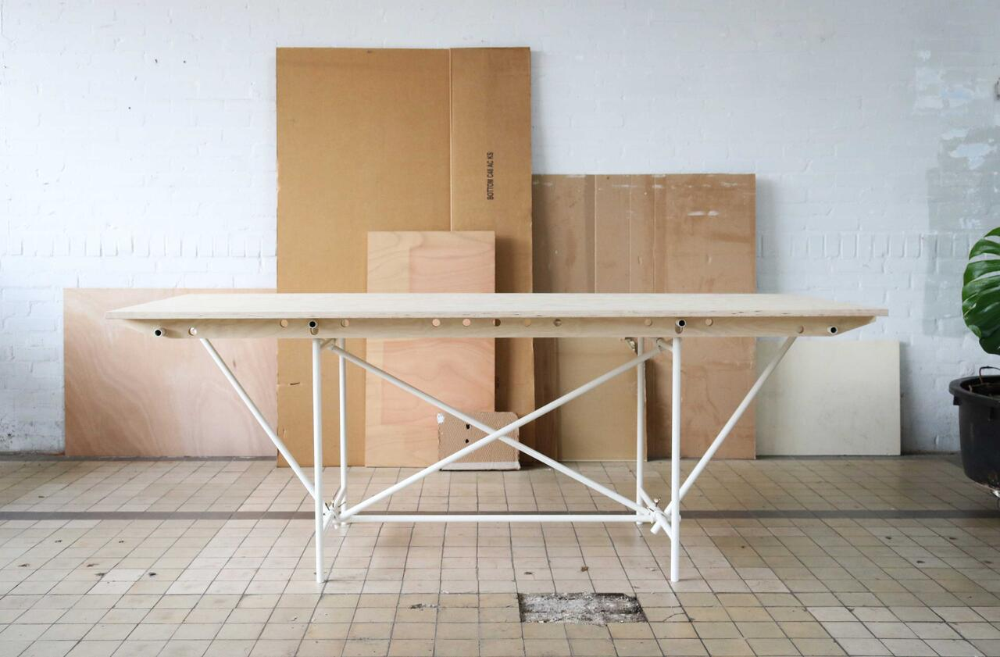
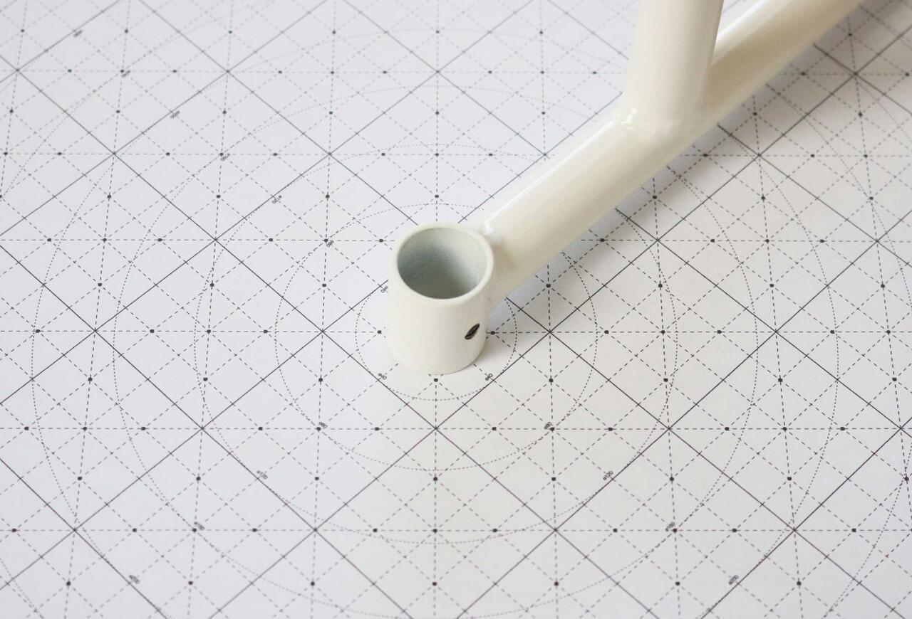

## Reflexión

El ejercicio me ayudó a cambiar el foco desde las cualidades de un objeto hacia las relaciones y procesos que lo hacen posible. También me permitió reconocer que conceptos como apertura, colaboración o circularidad no deberían agregarse al final del diseño, sino influir en cómo se piensa y desarrolla desde el comienzo.

La posible transición hacia la arquitectura vuelve estas preguntas más complejas, pero también más interesantes. Por ahora, me quedo con una idea para seguir investigando y es que quizás el valor de un proyecto no esté solamente en lo que construimos, sino también en las reglas y las posibilidades que permitan que otros experimenten.
