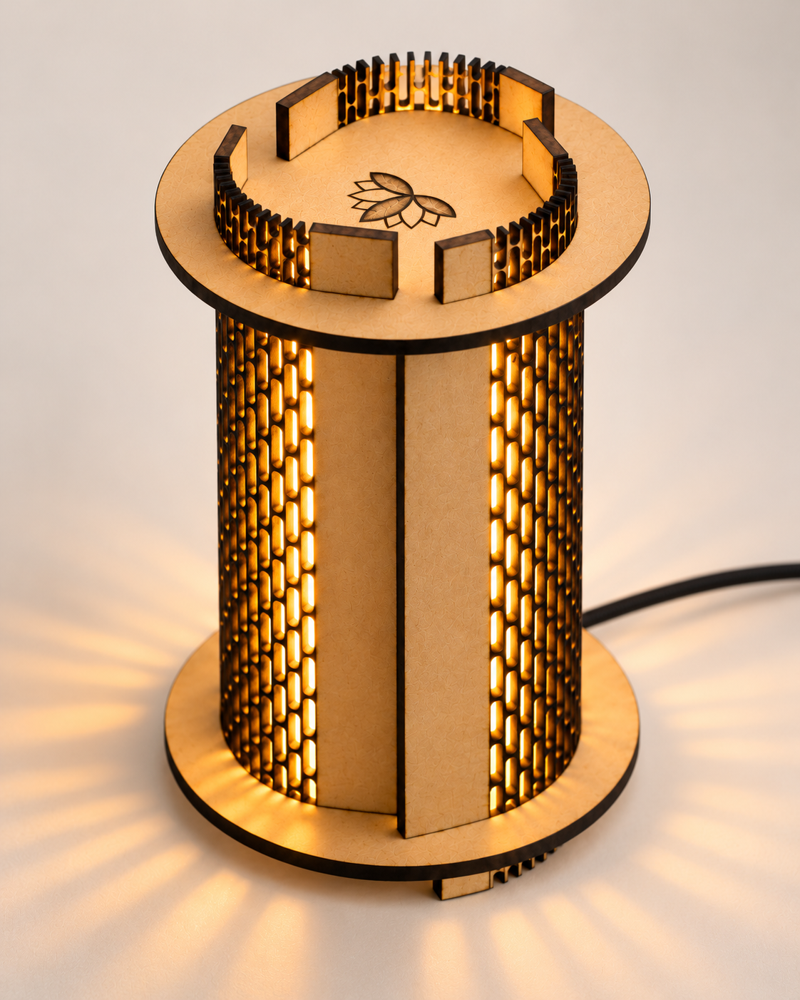
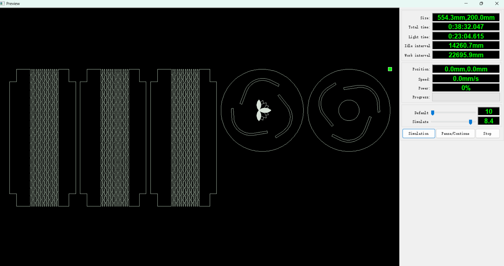
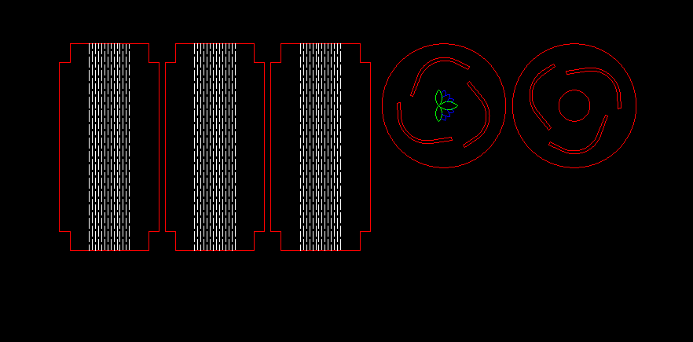
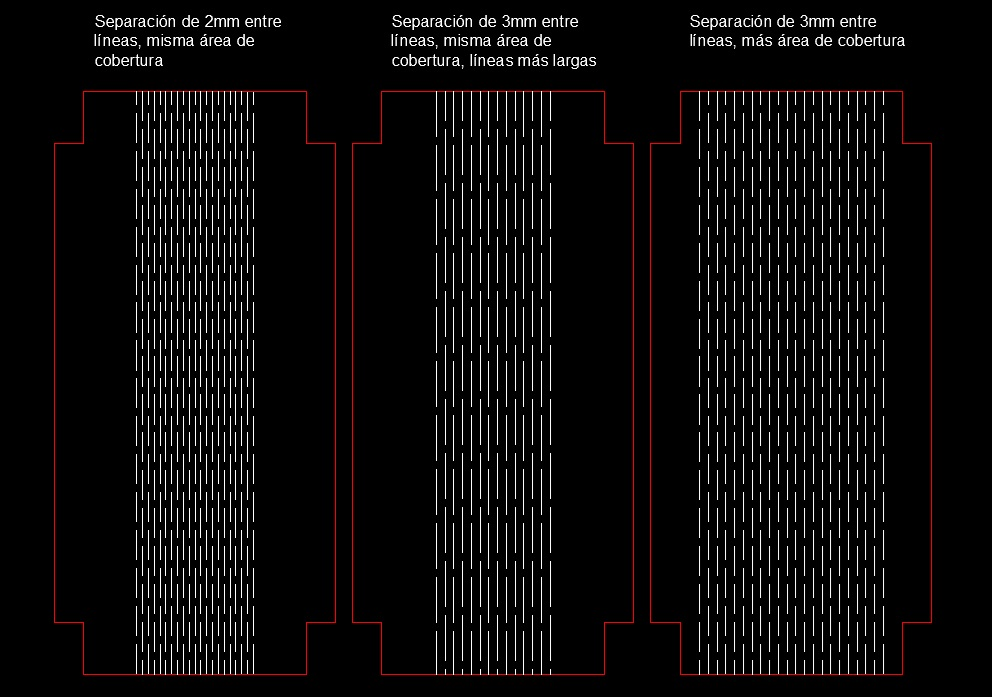

---
hide:
    - toc
---
# FP01 - Corte láser

### Contexto

Laboratorio al que asistimos: UTEC Minas

Fecha: 30 de octubre 2026

Máquina utilizada: cortadora láser de CO2

Software CM utilizado: RD Works

Objeto fabricado: luminaria

Material_ MDF 3mm

### Seteos iniciales

Al comienzo de la clase la docente encargada del laboratorio Florencia Pilatti nos explicó algunas cuestiones básicas del uso de la máquina: seguridad, calibración, chequeos iniciales y pasos para cargar archivos. También nos indicó que debemos setear el 0 de comienzo del archivo y chequear que el material sea suficiente haciendo una simulación de frame con el puntero.

### Experiencia de fabricación

El primer paso para fabricar mi luminaria fue aplicar el seteo del corte sugerido por la docente del laboratorio al archivo de corte ya trabajado en RD Works.

Como daba mucho tiempo de corte y una compañera ya había cortado un kerfing con diferente patrón (que había encontrado en internet), decidí cambiar el patrón para que en vez de quitar muchos elipses sea cortes de líneas nada mas. Esto lo hice en autocad para no tener que modelar otra vez la luminaria.

La separación del kerfing en este primer corte fue de 3mm entre líneas (la compañera que cortó antes lo había hecho de 2mm)

Como resultado las piezas no se doblaron lo suficiente como para encastrar en los espacios para ello. Incluso intenté forzarlas un poco hasta que una se quebró.

Como las bases habían quedado bien, decidí cortar otra vez pero haciendo algunas pruebas con los tres laterales para ver qué funcionaba mejor

La idea de estas pruebas era entender mejor cómo funcionaba el kerfing y qué cambio tenía mayor efecto y mejor resultado

Si bien ninguna de las 3 pruebas fue completamente satisfactoria, la única que haciendo bastante fuerza con cuidado logró encastrar fue la que se habpia disminuido la separación entre corte a 2mm, las otras dos no llegaron a curvarse lo necesario

### Reflexión

La experiencia fue muy buena porque más allá de la fabricación del objeto pude aprender cómo funciona la máquina, operarla y ver no solamente mis aprendizajes sino las dificultades y éxitos de los compañeros que también son parte del proceso. 

En cuanto a la fabricación del objeto, creo que si hubiese conservado el diseño original de kerfing hubiese funcionado bien mas allá del tiempo de corte (además hacer dos tiradas para probar me llevó más tiempo que el corte original). También creo que si bien una de las pruebas funcionó, estéticamente no hubiese quedado bien porque el kerfing estaba tan apretado que la luz no saldría. 

Como aprendizaje creo que para otra vez iría por un patrón de kerfing ya probado y no inventaría uno en el momento, que aunque basado en la experiencia de una compañera para mi caso no funcionó. Y también tomaría decisiones basadas más en mi propia intuición y tal vez no tanto en el tiempo de corte por ejemplo. 

En conclusión, la experiencia fue muy buena, aprendí mucho y me volví a casa con ganas de seguir experimentando 😍
